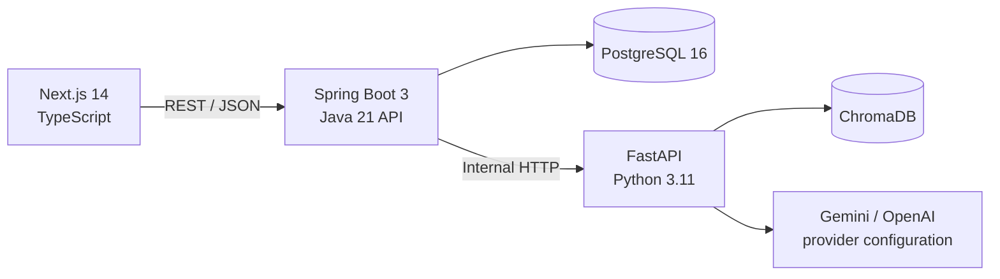

# CareerPilot AI

[](https://github.com/suvansha-ag21/CareerPilot-AI-v2/actions/workflows/ci.yml)
[](https://www.oracle.com/java/)
[](https://spring.io/projects/spring-boot)
[](https://nextjs.org/)
[](https://www.python.org/)
[](https://www.docker.com/)

CareerPilot AI is a career-preparation platform that helps job seekers turn their resume and target roles into a focused interview-preparation plan. It brings resume feedback, job-description matching, skill-gap analysis, personalized roadmaps, mock interviews, and progress tracking into one application.

The project is a full-stack monorepo: a **Next.js and TypeScript** web app, a **Spring Boot and Java** API, and a **FastAPI and Python** service for AI workflows. PostgreSQL stores application data; ChromaDB supports vector search for retrieval-augmented generation (RAG).

## What you can do

- **Analyze a resume:** extract skills, review resume sections, and get targeted improvement suggestions.
- **Compare a resume with a job description:** see matching, related, and missing skills.
- **Plan what to learn:** review skill gaps and generate a role-focused learning roadmap.
- **Practice interviews:** work through technical and behavioral interview sessions, get coaching hints, and review feedback.
- **Use interview practice tools:** run JavaScript in a browser Web Worker, try SQL exercises, and build system-design diagrams.
- **Track preparation:** manage job applications, review spaced-repetition drills, and view progress analytics.

## How it works



The Spring Boot API handles application requests and persistence. It calls the Python service for AI tasks such as resume analysis, job matching, skill-gap analysis, and interview assistance. The AI service uses a Sentence Transformers embedding model and ChromaDB for retrieval, with Gemini or OpenAI configured as the language-model provider.

## Technical highlights

- **Service separation:** Java/Spring Boot for the main API and Python/FastAPI for AI and NLP workflows.
- **Hybrid job matching:** combines semantic similarity with TF-IDF keyword analysis and skill classification.
- **RAG for interview assistance:** retrieves context from a computer-science knowledge base stored in ChromaDB.
- **Streaming coaching hints:** uses Server-Sent Events (SSE) to deliver interview hints as they are generated.
- **In-browser practice tools:** runs JavaScript in a Web Worker and provides SQL and system-design exercises in the frontend.
- **Shared TypeScript contracts:** the `shared/` workspace contains types and schemas used by the frontend.
- **Local orchestration and CI:** Docker Compose starts the services together; GitHub Actions checks backend packaging, frontend types, Python tests, and Docker image builds.

## Technology

| Area | Technologies |
| --- | --- |
| Frontend | Next.js 14, React 18, TypeScript, Tailwind CSS |
| API | Java 21, Spring Boot 3.3, Spring Security, Spring Data JPA |
| AI service | Python 3.11, FastAPI, Pydantic, scikit-learn, Sentence Transformers |
| Data | PostgreSQL 16, ChromaDB |
| Infrastructure | Docker, Docker Compose, GitHub Actions |

## Run locally with Docker Compose

### Prerequisites

- Git
- Docker Desktop (or Docker Engine with the Compose plugin)
- An API key for Gemini or OpenAI for provider-backed AI generation

### Start the application

Clone the repository and create environment files:

```powershell
git clone https://github.com/suvansha-ag21/CareerPilot-AI-v2.git
cd CareerPilot-AI-v2
Copy-Item .env.example .env
Copy-Item .env.example ai-service\.env
```

Set `INTERNAL_SERVICE_KEY` to the **same value** in both `.env` files. Add your provider key (for example, `GEMINI_API_KEY`) to `ai-service/.env`. Replace sample secrets with strong values for any non-local deployment, and never commit real credentials.

Build and start the services:

```powershell
docker compose up --build
```

| Service | Local address |
| --- | --- |
| Web application | <http://localhost:3000> |
| Spring Boot API | <http://localhost:5000> |
| API health check | <http://localhost:5000/api/health> |
| FastAPI service | <http://localhost:8000> |
| ChromaDB | <http://localhost:8001> |

Stop the containers with `Ctrl+C`, or run `docker compose down` in another terminal. PostgreSQL data is kept in a named Docker volume.

## Development and tests

The repository also includes npm scripts for common build and test tasks:

```bash
npm ci
npm run build
npm run typecheck
npm run test:backend
npm run test:ai
npm run test:all
```

For these commands, install Node.js 20 or newer, Java 21, and Python 3.11. The test scripts use the Maven wrapper for the backend and Python `unittest` for the AI service.

## Repository layout

```text
.
├── frontend/       Next.js application and interview-practice UI
├── backend/        Spring Boot API, security, and persistence
├── ai-service/     FastAPI endpoints, NLP, RAG, and AI workflows
├── shared/         Shared TypeScript types and schemas
├── database/       Database-related schemas, seeds, and vector data
├── docs/           API specification
└── .github/        GitHub Actions workflow
```

For deeper project walkthroughs and interview talking points, see the [portfolio presentation guide](PORTFOLIO_PRESENTATION_GUIDE.md). For endpoint details, see the [API specification](docs/API_SPEC.md).
