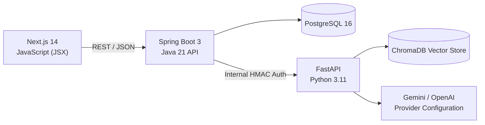

# CareerPilot AI

[](https://github.com/suvansha-ag21/CareerPilot-AI-v2/actions/workflows/ci.yml)
[](https://developer.mozilla.org/en-US/docs/Web/JavaScript)
[](https://nextjs.org/)
[](https://www.oracle.com/java/)
[](https://spring.io/projects/spring-boot)
[](https://www.python.org/)
[](https://www.postgresql.org/)
[](https://www.trychroma.com/)
[](https://www.docker.com/)

CareerPilot AI is an AI-powered career preparation platform designed to help technical job seekers transform their resumes and target roles into a structured, role-specific interview preparation plan. It unifies resume critique, job-description matching, topological skill-gap roadmaps, adaptive mock interviews with real-time hint streaming, and spaced-repetition flashcards into one cohesive application.

The project is built as a production-grade full-stack monorepo:
- **Frontend**: Next.js 14 App Router in pure **JavaScript (ESNext / JSX)** with Tailwind CSS and Recharts.
- **API Gateway**: **Java 21 + Spring Boot 3.3** REST API with Spring Security, JWT authentication, and Spring Data JPA.
- **AI Microservice**: **Python 3.11 + FastAPI** microservice powering RAG vector search with **ChromaDB**, **Sentence Transformers (`BAAI/bge-small-en-v1.5`)**, Scikit-learn TF-IDF, and multi-LLM orchestration (Gemini / OpenAI).

---

## What You Can Do

- **ATS Resume Intelligence:** Extract technical skills, evaluate section completeness, and generate tailored PDF exports.
- **Hybrid Job Description Matcher:** Compare resumes against job descriptions combining semantic cosine embeddings, TF-IDF n-grams, and canonical skill taxonomies (*Matching*, *Related*, and *Missing* skills).
- **Skill Gap Roadmaps:** Topologically sort prerequisites from beginner to advanced concepts with actionable milestone roadmaps.
- **Live Mock Interview Studio:** Interactive sessions supporting Web Worker JavaScript sandboxing, relational SQL exercises, system design canvas diagrams, and real-time Server-Sent Events (SSE) coaching hints.
- **Spaced-Repetition Drills:** SM-2 spaced repetition flashcards automatically scheduled from weak interview topics.
- **Pipeline Tracking & AI Telemetry:** Kanban and tabular application tracking alongside real-time AI latency and fallback observability.

---

## Architecture Overview



---

## Technology Stack

| Domain | Technologies |
| :--- | :--- |
| **Frontend** | Next.js 14, React 18, JavaScript (ESNext / JSX), Tailwind CSS, Framer Motion, Recharts |
| **Backend API** | Java 21, Spring Boot 3.3, Spring Security, Spring Data JPA, Hibernate, Nimbus-JOSE / JWT |
| **AI / ML Service** | Python 3.11, FastAPI, Uvicorn, Sentence Transformers (`BAAI/bge-small-en-v1.5`), Scikit-learn, ChromaDB, Pydantic |
| **Database & Cache** | PostgreSQL 16, ChromaDB (Pre-indexed 9-topic CS Knowledge Base) |
| **DevOps & Cloud** | Multi-Stage Docker, Docker Compose, GitHub Actions CI/CD |

---

## Running with Docker Compose (Recommended)

### Prerequisites

- Git
- Docker Desktop (running)
- Gemini or OpenAI API Key (for LLM capabilities)

### Quick Start

1. **Clone the repository:**
   ```powershell
   git clone https://github.com/suvansha-ag21/CareerPilot-AI-v2.git
   cd CareerPilot-AI-v2
   ```

2. **Set up environment configurations:**
   ```powershell
   Copy-Item .env.example .env
   Copy-Item .env.example ai-service\.env
   ```
   *Add your `GEMINI_API_KEY` to `ai-service\.env` and ensure `INTERNAL_SERVICE_KEY` matches in both `.env` files.*

3. **Build and start all services:**
   ```powershell
   docker compose up --build
   ```

### Live Service Endpoints

| Service | Address | Description |
| :--- | :--- | :--- |
| **Web Application** | <http://localhost:3000> | Next.js 14 JavaScript Frontend |
| **Spring Boot API** | <http://localhost:5000> | REST API Gateway |
| **API Health Check** | <http://localhost:5000/api/health> | Health status of Gateway, DB, and AI service |
| **AI Microservice Docs** | <http://localhost:8000/internal/ai/docs> | FastAPI Interactive Swagger UI |
| **ChromaDB** | <http://localhost:8001> | Vector Store HTTP endpoint |

*To stop all containers: press `Ctrl+C` or execute `docker compose down`.*

---

## Running Locally (Without Docker)

If developing outside Docker, launch each service in its own terminal:

```powershell
# 1. AI Microservice (Python FastAPI)
cd ai-service
.\.venv\Scripts\uvicorn app.main:app --reload --port 8000

# 2. Backend Gateway (Spring Boot)
cd backend
.\mvnw.cmd spring-boot:run

# 3. Frontend Web App (Next.js)
npm run dev:frontend
```

---

## Development & Test Commands

The root workspace includes convenience scripts for verification:

```bash
# Build frontend production bundle
npm run build:frontend

# Run AI microservice unit tests
npm run test:ai

# Run Spring Boot backend tests
npm run test:backend

# Run all test suites
npm run test:all
```

---

## Repository Structure

```text
.
├── frontend/       Next.js 14 JavaScript (JSX) application & interview studio
├── backend/        Spring Boot 3 (Java 21) REST API, JWT auth, and persistence
├── ai-service/     FastAPI microservice: ChromaDB RAG, Sentence Transformers & NLP
├── shared/         Shared JavaScript schemas (Zod), enums, and constants
├── database/       PostgreSQL schemas, seeds, and pre-indexed Chroma vector data
├── docs/           API specifications & architectural contracts
├── .github/        Multi-job GitHub Actions CI/CD workflow
└── docker-compose.yml Multi-service container orchestration
```

For detailed technical interview questions, architecture talking points, and resume bullet points, see the [Portfolio Presentation Guide](PORTFOLIO_PRESENTATION_GUIDE.md).
